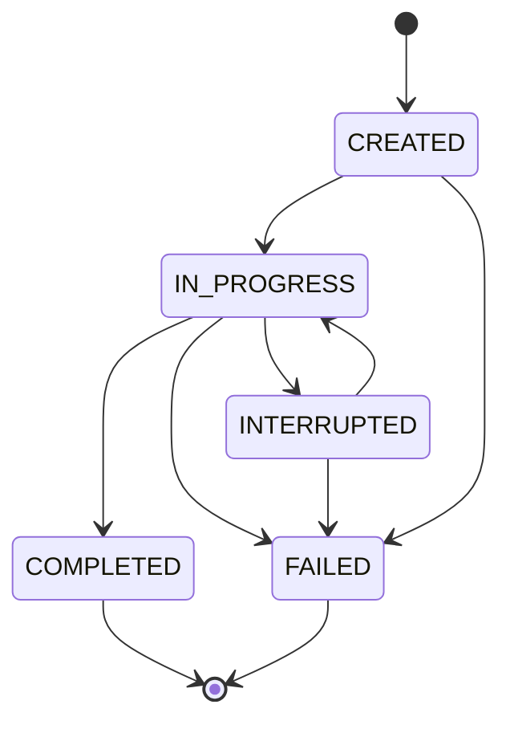
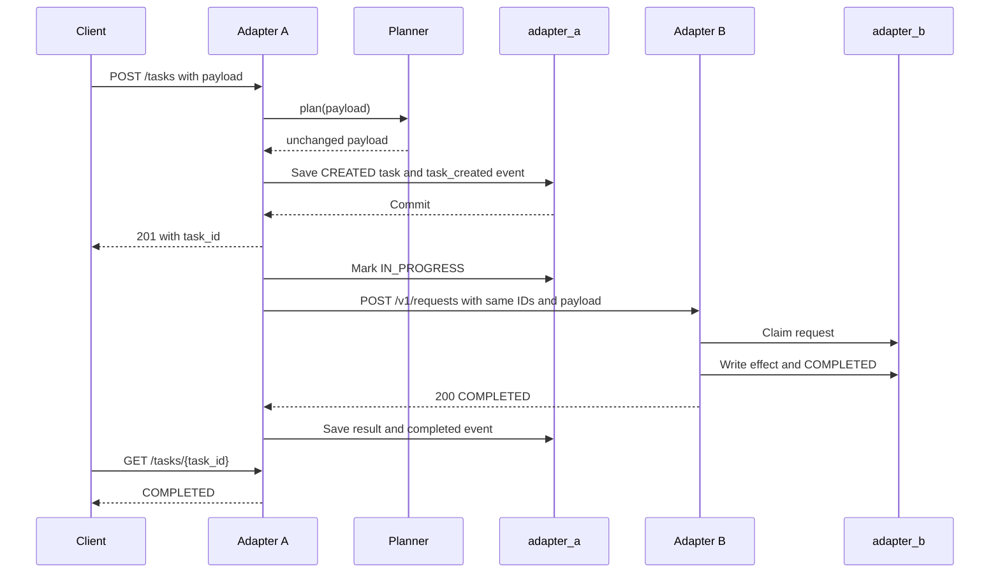
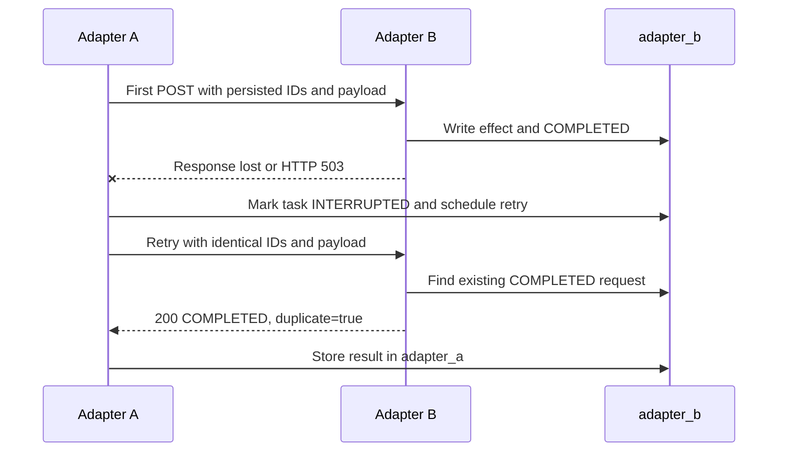

# PS-021 — Experimental Dialog Correlation and Recovery Across Agent Adapters

PS-021 is an experimental prototype for the AIORI-3 hackathon, team 404 Crew, category 6G and Future Networks. It demonstrates dialog correlation and recovery between two agent adapters implemented with different frameworks: Adapter A uses Spring Boot and initiates work; Adapter B uses FastAPI and executes a durable mock effect.

## Problem and goal

Agents using different frameworks or MCP/A2A-style integration patterns can lose context, repeat side effects, or become ambiguous when an agent restarts or a network response is lost.

This prototype addresses that problem with:

- explicit `dialog_id`, `task_id`, and `request_id` identifiers;
- durable lifecycle state in Adapter A;
- durable request claims and results in Adapter B;
- payload hashing and duplicate detection;
- retry and restart recovery using the same persisted identifiers and payload.

The dialog context represented here is identifiers, lifecycle state, and task payload. It does not contain model prompts or conversation memory.

## Scope and claims

The supported claim is:

> Effectively-once behavior for the mock effect, a database write, under the failure scenarios covered by the available tests and result artifacts.

This project does **not** claim:

- a final IETF-standard implementation;
- complete MCP interoperability;
- complete A2A interoperability;
- universal exactly-once message delivery;
- exactly-once worker execution after stale-claim takeover.

The schema is experimental and is inspired by discussions around interoperable agent protocols, including the IETF agentproto work.

## Architecture

```mermaid
flowchart LR
    Client[Client or test script]
    A[Adapter A<br/>Spring Boot]
    Planner[Passthrough planner]
    Poller[Dispatcher / poller]
    B[Adapter B<br/>FastAPI]
    Worker[Stub worker]
    DB[(PostgreSQL)]
    ADB[(schema adapter_a)]
    BDB[(schema adapter_b)]

    Client -->|POST /tasks| A
    A --> Planner
    Planner --> A
    A -->|persist task before send| ADB
    Poller -->|POST /v1/requests| B
    B --> Worker
    B -->|persist request and effect| BDB
    ADB --- DB
    BDB --- DB
    A -->|GET /tasks/{task_id}| Client
```

Adapter A and Adapter B are peer adapters. Each adapter owns its own PostgreSQL schema and does not write the other adapter's tables. Adapter A generates the three identifiers. Adapter B deduplicates requests using `(dialog_id, request_id)` and stores the mock effect durably.

### Design decisions and why

| Decision | Reason |
|---|---|
| Peer adapters | Demonstrates cross-framework coordination without a shared application model. |
| Adapter A generates identifiers | The initiating side owns task identity before the first send. |
| Deduplication key `(dialog_id, request_id)` | A primary key identifies one logical request at Adapter B. |
| Payload hash | A changed payload with the same request identity is rejected. |
| Effect and `COMPLETED` in one transaction | Prevents a completed request from being recorded without its effect. |
| Persist task before first send | A restart can recover the exact task, identifiers, and payload. |
| No HTTP or planner call inside a database transaction | Keeps database transactions short and makes transport failures explicit. |
| One mechanism for first send, retry, and recovery | Prevents retry paths from regenerating identifiers or invoking the planner again. |
| PostgreSQL only | Both adapters use durable relational state and database constraints. |

## Dialog-state schema

### Adapter A

Adapter A stores the following information in `adapter_a.tasks`:

| Field | Meaning |
|---|---|
| `task_id` | Client-visible task identifier and primary key. |
| `dialog_id` | Identifier for the correlated dialog. |
| `request_id` | Identifier sent to Adapter B for deduplication. |
| `payload` | Validated JSON task payload. |
| `state` | `CREATED`, `IN_PROGRESS`, `INTERRUPTED`, `COMPLETED`, or `FAILED`. |
| `attempt_count` | Number of send attempts started by Adapter A. |
| `result` | Result returned by Adapter B after completion. |
| `last_error` | Latest transport, contract, or processing error. |
| `next_retry_at` | Earliest time at which a retry is eligible. |
| `version` | JPA optimistic-locking version. |
| `created_at`, `updated_at` | Lifecycle timestamps. |

Adapter A stores transport and lifecycle history in `adapter_a.dialog_events`.

### Adapter B

Adapter B stores requests in `adapter_b.requests`:

- `(dialog_id, request_id)` is the primary key;
- `task_id` is retained with the request;
- `payload_hash` identifies the parsed payload;
- `status` is `PROCESSING`, `COMPLETED`, or `FAILED`;
- `result_data` and `error_message` hold the durable outcome;
- `attempt_count` and `claimed_at` support stale-claim takeover.

Adapter B stores one mock effect per request in `adapter_b.effects`. The table has a unique constraint on `(dialog_id, request_id)`. Adapter B also stores request events in `adapter_b.dialog_events`.

### Identifiers and payload

Adapter A generates `dialog_id`, `task_id`, and `request_id` as lowercase UUID strings. Adapter B accepts non-empty string identifiers.

The validated task payload is:

```json
{
  "action": "record_order",
  "parameters": {
    "item": "widget",
    "quantity": 3
  }
}
```

The current validation rules are:

- `action` must be `record_order`;
- `item` must be a string from 1 to 64 characters;
- `quantity` must be an integer from 1 to 1000;
- no additional keys are allowed;
- decimal quantities are rejected.

Payload hashing uses canonical JSON:

- object keys sorted lexicographically;
- compact separators;
- no spaces;
- UTF-8 encoding;
- `ensure_ascii=false`;
- SHA-256 hexadecimal output.

For the test payload above, the canonical JSON is:

```text
{"action":"record_order","parameters":{"item":"widget","quantity":3}}
```

The SHA-256 value is:

```text
8a0b2b1f616efe8d5e14590a6c154f7dd7c9962fad8daf9ae80bb45dbb9c055e
```

## Lifecycle and state machine



The allowed transitions are defined in Adapter A's transition map and covered by `TaskTransitionsTest`.

| Adapter B request status | Adapter B response | Adapter A result |
|---|---|---|
| New claim | `COMPLETED` | `COMPLETED` |
| New claim | `FAILED` | `FAILED` |
| Existing fresh `PROCESSING` claim | `IN_PROGRESS` | `INTERRUPTED`, retry scheduled |
| Existing stale `PROCESSING` claim | Worker proceeds | Adapter A eventually receives `COMPLETED` or `FAILED` |
| Existing `COMPLETED` request | `COMPLETED`, `duplicate=true` | `COMPLETED` |
| Existing `FAILED` request | `FAILED`, `duplicate=true` | `FAILED` |
| HTTP 409 or other 4xx | No valid success response | `FAILED`, no retry |
| Timeout, connection failure, reset, 5xx, or invalid 2xx | No durable response available | `INTERRUPTED`, retry scheduled |
| Retry limit reached without completion | No completion | `FAILED` with `max attempts exceeded` |

`COMPLETED` and `FAILED` are terminal states. At startup, Adapter A changes unfinished `IN_PROGRESS` tasks to `INTERRUPTED`.

## How Adapter A works

Adapter A is implemented in [adapter-a-spring](./adapter-a-spring).

### HTTP endpoints

| Method | Endpoint | Purpose |
|---|---|---|
| `POST` | `/tasks` | Validate and persist a new task. Returns `201 Created`. |
| `GET` | `/tasks/{task_id}` | Retrieve task state and result. |

The client polls Adapter A. It does not call Adapter B directly for normal task processing.

### Creation flow

1. Adapter A receives `{"payload": {...}}`.
2. The passthrough planner returns the payload unchanged.
3. Adapter A validates the payload.
4. Adapter A generates three UUID identifiers.
5. Adapter A saves the task as `CREATED` and writes the first dialog event in one short transaction.
6. The poller later performs the first send.

Spring AI is not present in the current build. A non-passthrough planner is not implemented. The configured planner mode is currently hard-coded to passthrough; unsupported modes fail during startup.

### Dispatcher and poller

The poller selects eligible `CREATED` and `INTERRUPTED` tasks. The dispatcher:

1. marks the task `IN_PROGRESS`;
2. increments `attempt_count`;
3. writes a sending event;
4. sends the stored identifiers and payload to Adapter B;
5. applies the explicit response-to-state mapping.

Retries and startup recovery use the same dispatcher path. The planner is not called again after the task has been persisted.

### Retry configuration

| Property | Environment variable | Default |
|---|---|---:|
| `b.base-url` | `B_BASE_URL` | `http://localhost:8000` |
| `b.connect-timeout-ms` | `B_CONNECT_TIMEOUT_MS` | `2000` |
| `b.read-timeout-ms` | `B_READ_TIMEOUT_MS` | `5000` |
| `retry.backoff-ms` | `RETRY_BACKOFF_MS` | `3000` |
| `retry.max-attempts` | `RETRY_MAX_ATTEMPTS` | `15` |
| `retry.poll-interval-ms` | `RETRY_POLL_INTERVAL_MS` | `1000` |

The retry-window constraint is:

```text
max-attempts × backoff > STALE_CLAIM_SECONDS + read timeout
```

The default Adapter A settings provide a 45-second retry window. This is shorter than Adapter B's documented default stale-claim period of 90 seconds, so deployments using the default B stale-claim value must configure the values consistently before relying on stale-claim recovery.

### Fault-header forwarding

When `FAULT_INJECTION=true`, an `X-Fault` header supplied to `POST /tasks` is held in memory by `task_id`. It is forwarded only on the first attempt and then discarded. The header is not stored in PostgreSQL and is never placed inside the payload.

This is a development and test facility. It is not intended as a production control plane.

### Normal request sequence



### Retry after a lost response



## How Adapter B works

Adapter B is implemented in [adapter-b-fastapi](./adapter-b-fastapi).

### HTTP endpoints

| Method | Endpoint | Purpose |
|---|---|---|
| `GET` | `/healthz` | Returns `{"status":"healthy"}`. |
| `POST` | `/v1/requests` | Claims, executes, and replays requests. |

The current source also exposes a root `/` endpoint returning a basic greeting. It is not part of the adapter contract.

### Atomic claim and replay

Adapter B computes the payload hash and attempts:

```sql
INSERT INTO adapter_b.requests (...)
VALUES (...)
ON CONFLICT (dialog_id, request_id) DO NOTHING
```

A new row claims the request as `PROCESSING`.

For an existing request:

- a different payload hash returns HTTP 409 with `payload_mismatch`;
- `COMPLETED` returns the stored result with `duplicate=true`;
- `FAILED` returns the stored error with `duplicate=true`;
- a fresh `PROCESSING` claim returns `IN_PROGRESS`;
- a stale `PROCESSING` claim can be taken over.

The default `STALE_CLAIM_SECONDS` value is `90`.

### Worker

The current worker factory supports only the stub worker:

```text
run(payload) -> dict
```

The stub returns:

```json
{
  "worker": "stub",
  "echo": {
    "...": "payload"
  }
}
```

A Hugging Face or other agent worker is not present in the current source and is therefore planned.

### Fault injection

When `FAULT_INJECTION=true`, Adapter B accepts `X-Fault` values:

- `drop-response`;
- `crash-before`;
- `crash-during`;
- `delay=<milliseconds>`.

Invalid values return HTTP 400. Fault injection is disabled unless explicitly enabled.

### Adapter B environment variables

| Variable | Purpose | Default | Required |
|---|---|---|---|
| `DATABASE_URL` | PostgreSQL connection string | None | Yes |
| `STALE_CLAIM_SECONDS` | Stale-claim takeover threshold | `90` | No |
| `FAULT_INJECTION` | Enables fault headers | Disabled unless `true` | No |
| `AGENT_MODE` | Worker selection | `stub` | No |
| `GREET_MODE` | Used only by the unused greeting helper | `polite` | No |

Do not place credentials in this README, source files, tests, logs, or command examples.

## End-to-end request lifecycle

### First request

1. A client submits a payload to `POST /tasks`.
2. Adapter A validates the payload and generates `dialog_id`, `task_id`, and `request_id`.
3. Adapter A persists the task as `CREATED` before any HTTP call.
4. Adapter A's poller marks the task `IN_PROGRESS`.
5. Adapter A sends the same three identifiers and stored payload to Adapter B.
6. Adapter B atomically claims `(dialog_id, request_id)`.
7. The stub worker produces a result.
8. Adapter B writes the effect and marks the request `COMPLETED` in one transaction.
9. Adapter A stores the result and marks the task `COMPLETED`.
10. The client reads the result using `GET /tasks/{task_id}`.

### Duplicate request

1. Adapter A retries with the original identifiers and payload.
2. Adapter B finds the existing `(dialog_id, request_id)` row.
3. If the row is `COMPLETED`, Adapter B returns the stored result with `duplicate=true`.
4. Adapter B does not invoke the worker again.
5. Adapter A remains or becomes `COMPLETED`.

The identifiers and payload do not change between attempts.

### Crash during processing

1. Adapter B claims the request as `PROCESSING`.
2. Adapter B stops before completing the request.
3. Adapter A records a transport failure and schedules a retry.
4. Adapter B restarts.
5. A retry uses the same identifiers and payload.
6. If the claim is stale, Adapter B takes it over.
7. Adapter B completes the request and writes one durable effect.
8. Adapter A eventually becomes `COMPLETED`.

## Durability and deduplication

Adapter A persists the task, identifiers, payload, retry state, and result in `adapter_a`. Adapter B persists the request claim, payload hash, result, and effect in `adapter_b`.

A restart of Adapter A does not lose a persisted task because startup recovery changes unfinished `IN_PROGRESS` tasks to `INTERRUPTED`. A restart of Adapter B does not lose completed requests because request and effect rows are stored in PostgreSQL.

A duplicate cannot create a second durable effect because:

- `(dialog_id, request_id)` is the primary key of `adapter_b.requests`;
- `(dialog_id, request_id)` is unique in `adapter_b.effects`;
- completed requests replay the stored result without invoking the worker.

A stale-claim takeover can allow the worker itself to run twice if the original worker continues after its claim becomes stale. The unique effect constraint prevents a second durable mock effect. Therefore the claim is effectively-once for the tested database effect, not exactly-once worker execution.

## Disconnect and retry scenarios

The following statuses are based only on archived result artifacts and test reports in the repository. Fake-B results are explicitly labeled as simulator results. No real Adapter A-to-Adapter B integration result was found.

| Scenario | How it is caused | Expected outcome | Status | Evidence |
|---|---|---|---|---|
| Agent disconnects before processing | Adapter B unavailable before the first send | Adapter A retries the persisted task and eventually completes | Passed in fake-B simulator artifact | `adapter-a-spring/target/scenario-results/s1-b-down-before-send.json`; `tests/results/b_down_before_send.json` |
| Agent disconnects while processing | Adapter B crashes during processing | Adapter A retries with the same IDs; stale claim can be taken over | Passed in fake-B simulator artifact | `adapter-a-spring/target/scenario-results/s2-crash-during.json`; `tests/results/b_killed_while_processing.json` |
| Work completes but response is lost | Adapter B completes durable work, then returns an empty 503 | Adapter A retries and receives the stored result with `duplicate=true` | Passed in fake-B simulator artifact | `adapter-a-spring/target/scenario-results/s3-drop-response.json`; `tests/results/response_lost.json` |
| Agent restarts after completion | Adapter B restarts before a duplicate retry | Adapter B replays the stored result and does not create another effect | Passed in archived scenario artifact; Adapter B report also records this test | `tests/results/b_restart_after_completion.json`; `docs/test_results.md` |
| Retry arrives during recovery | Recovery and retry overlap around a stale or unfinished claim | One durable effect and a completed final state | Passed in archived scenario artifact; current root fault helper is incomplete | `tests/results/retry_during_recovery.json`; `tests/faults.py` |

## Test results

### Adapter A

Existing Surefire reports show:

| Test class | Tests | Failures | Errors | Skipped |
|---|---:|---:|---:|---:|
| `CanonicalJsonTest` | 3 | 0 | 0 | 0 |
| `TaskTransitionsTest` | 3 | 0 | 0 | 0 |
| `PayloadValidatorTest` | 5 | 0 | 0 | 0 |
| `FakeBIntegrationTest` | 4 | 0 | 0 | 0 |
| `AdapterASpringApplicationTests` | 1 | 0 | 0 | 1 |

The Adapter A integration tests use `FakeBServer`, which is explicitly documented in the source as a simulator and not Adapter B.

The archived Adapter A fake-B scenarios cover:

- B unavailable before send;
- crash during processing;
- dropped response;
- delayed processing.

### Adapter B

The repository's [test results](./docs/test_results.md) record the following command and output:

```text
uv run --project adapter-b-fastapi pytest -q tests
......                                                                   [100%]
6 passed in 5.87s
```

The recorded cases are:

- duplicate request without a second worker call;
- payload mismatch;
- concurrent identical requests;
- response lost after durable completion;
- restart after completion;
- stale-claim recovery.

### Additional tests

The following requested scenarios are not fully verified by current executable tests:

- same request identity with a different payload;
- illegal transition behavior across the HTTP boundary;
- Adapter A restart in a real Adapter A plus Adapter B integration;
- planner invocation count across retry.

The root scenario tests contain explicit `NotImplementedError` TODOs for some of these cases. Their JSON result files are retained as artifacts but should not be treated as a fresh end-to-end test run.

## Technology stack and versions

| Component | Version or status |
|---|---|
| Java | 21 |
| Spring Boot | 4.1.1 |
| Adapter A | Spring Boot, JPA, Flyway, RestClient, PostgreSQL |
| Python | 3.11 |
| Adapter B | FastAPI, psycopg 3, PostgreSQL |
| Worker | Stub implemented |
| MCP binding | Planned |
| LangGraph | Planned |
| Spring AI | Planned or absent |
| HF agent worker | Planned |
| PostgreSQL | Required; exact server version is not pinned in the source |
| Docker Compose | Planned; no compose file is present |

## Repository layout

```text
.
├── adapter-a-spring/       Spring Boot initiator
├── adapter-b-fastapi/      FastAPI executor
├── contract/               Payload schema and canonicalization test vectors
├── docs/                   Version notes and archived test results
├── tests/                  Cross-adapter scenario tests and result artifacts
├── Proposed-structure-hackathon.pdf
└── README.md               Project documentation
```

Generated directories such as `.venv`, `target`, `.idea`, caches, and compiled artifacts are intentionally omitted.

## Getting started

### Prerequisites

- Java 21;
- Maven Wrapper included in `adapter-a-spring`;
- Python 3.11;
- `uv` for the recorded Adapter B test command;
- PostgreSQL;
- a PostgreSQL database accessible to both adapters.

Use one PostgreSQL instance with separate schemas:

- Adapter A uses `adapter_a`;
- Adapter B uses `adapter_b`.

Adapter A creates and migrates its schema through Flyway. Adapter B creates its schema from `adapter-b-fastapi/sql/schema.sql` at application startup.

### Adapter A environment

| Variable | Purpose | Default | Required |
|---|---|---|---|
| `DB_HOST` | PostgreSQL host | `localhost` | No |
| `DB_PORT` | PostgreSQL port | `5432` | No |
| `DB_NAME` | Database name | `adapter_a` | No |
| `DB_USER` | Database user | None | Yes |
| `DB_PASSWORD` | Database password | None | Yes |
| `B_BASE_URL` | Adapter B base URL | `http://localhost:8000` | No |
| `B_CONNECT_TIMEOUT_MS` | Adapter B connection timeout | `2000` | No |
| `B_READ_TIMEOUT_MS` | Adapter B read timeout | `5000` | No |
| `RETRY_BACKOFF_MS` | Delay between retries | `3000` | No |
| `RETRY_MAX_ATTEMPTS` | Maximum attempts | `15` | No |
| `RETRY_POLL_INTERVAL_MS` | Poller interval | `1000` | No |
| `FAULT_INJECTION` | Enables development fault forwarding | `false` | No |

The current source configures `planner.mode=passthrough` directly. A `PLANNER_MODE` environment variable is not wired in the current code.

### Adapter B environment

| Variable | Purpose | Default | Required |
|---|---|---|---|
| `DATABASE_URL` | PostgreSQL connection string | None | Yes |
| `STALE_CLAIM_SECONDS` | Stale-claim threshold | `90` | No |
| `FAULT_INJECTION` | Enables fault headers | Disabled unless `true` | No |
| `AGENT_MODE` | Worker mode | `stub` | No |

Do not put a real credential in shell history copied into documentation.

### Run Adapter B

From `adapter-b-fastapi`:

```powershell
$env:DATABASE_URL = "<postgres-connection-string>"
uvicorn main:app --reload --port 8000
```

This command was not run while preparing this README draft.

### Run Adapter A

From the repository root:

```powershell
$env:DB_USER = "<db-user>"
$env:DB_PASSWORD = "<db-password>"
$env:B_BASE_URL = "http://localhost:8000"
.\adapter-a-spring\mvnw.cmd -f .\adapter-a-spring\pom.xml spring-boot:run
```

This command was not run while preparing this README draft.

### Run Adapter A tests

```powershell
.\adapter-a-spring\mvnw.cmd -f .\adapter-a-spring\pom.xml test
```

This command was not run while preparing this README draft. Existing Surefire reports are summarized above.

### Run Adapter B tests

The archived test-results document records:

```powershell
uv run --project adapter-b-fastapi pytest -q tests
```

The archived output reports six passing tests in 5.87 seconds. A new run was not performed while preparing this README draft.

### End-to-end PowerShell example

Create a task:

```powershell
$payload = @{
    payload = @{
        action = "record_order"
        parameters = @{
            item = "widget"
            quantity = 3
        }
    }
} | ConvertTo-Json -Depth 5

$created = Invoke-RestMethod `
    -Method Post `
    -Uri "http://localhost:8080/tasks" `
    -ContentType "application/json" `
    -Body $payload

$created
```

Poll the task:

```powershell
Invoke-RestMethod `
    -Method Get `
    -Uri "http://localhost:8080/tasks/$($created.task_id)"
```

Send the same request directly to Adapter B to demonstrate duplicate replay:

```powershell
$bRequest = @{
    dialog_id = $created.dialog_id
    task_id = $created.task_id
    request_id = $created.request_id
    payload = @{
        action = "record_order"
        parameters = @{
            item = "widget"
            quantity = 3
        }
    }
} | ConvertTo-Json -Depth 5

Invoke-RestMethod `
    -Method Post `
    -Uri "http://localhost:8000/v1/requests" `
    -ContentType "application/json" `
    -Body $bRequest
```

The expected duplicate response is `COMPLETED` with `duplicate=true`, assuming the original request completed.

Send a changed payload with the same identifiers:

```powershell
$mismatch = @{
    dialog_id = $created.dialog_id
    task_id = $created.task_id
    request_id = $created.request_id
    payload = @{
        action = "record_order"
        parameters = @{
            item = "different-widget"
            quantity = 3
        }
    }
} | ConvertTo-Json -Depth 5

Invoke-RestMethod `
    -Method Post `
    -Uri "http://localhost:8000/v1/requests" `
    -ContentType "application/json" `
    -Body $mismatch
```

The expected result is HTTP 409 with `payload_mismatch`. These commands were not run while preparing this README draft.

## Demo script

1. Start PostgreSQL and configure both adapters.
2. Start Adapter B on port 8000.
3. Start Adapter A.
4. Submit the `record_order` payload to `POST /tasks`.
5. Record the returned `task_id`, `dialog_id`, and `request_id`.
6. Poll `GET /tasks/{task_id}` until the task is `COMPLETED`.
7. Inspect the corresponding row in `adapter_a.tasks`.
8. Inspect the Adapter B request and effect rows.
9. Resend the same identifiers and payload directly to Adapter B.
10. Confirm that Adapter B returns the stored result with `duplicate=true`.
11. Resend the same identifiers with a changed payload.
12. Confirm HTTP 409 and no additional effect row.

## Limitations and known issues

- The effect is a mock database write, not a real-world external side effect.
- The prototype uses one PostgreSQL instance.
- MCP and A2A interoperability are not implemented as protocol bindings.
- A stale-claim takeover can cause the worker to execute twice, although the effect is constrained to one row.
- A client that submits the same logical operation to `POST /tasks` multiple times receives multiple Adapter A tasks; client-level duplicate creation is not deduplicated.
- Fault forwarding is intended only for development and testing.
- Adapter A's planner is passthrough only.
- Adapter B currently supports only the stub worker.
- The current `PLANNER_MODE` environment variable described in the agreed contract is not wired in the source; planner mode is configured by `planner.mode`.
- The archived root scenario helpers include unimplemented fault-injection TODOs.
- No real Adapter A-to-Adapter B integration result was found in the repository.
- The default retry window must be configured with the Adapter B stale-claim threshold; the default Adapter A values do not exceed the documented default B threshold.
- No Docker Compose packaging is present.

## Roadmap

- Add a real planner behind an explicit configuration boundary.
- Add a real agent worker while preserving the durable claim/effect protocol.
- Add MCP binding.
- Add fuller A2A-style interoperability.
- Add Docker Compose packaging.
- Complete the real cross-adapter integration suite.
- Replace archived simulator artifacts with reproducible integration results.
- Complete the hackathon report.
- Produce the demonstration video.

## Hackathon deliverables checklist

| Deliverable | Status |
|---|---|
| Private repository named after the team | Unknown, confirm with team |
| `aiori-hackathon` collaborator access | Unknown, confirm with team |
| Ownership transfer | Unknown, confirm with team |
| PDF following organiser structure | A PDF draft exists; final compliance is unknown, confirm with team |
| Prototype demo with pseudocode snippet | Unknown, confirm with team |
| Video with three speakers | Not found in this repository; confirm with team |
| Final report | Not found in this repository; confirm with team |

## Team and roles

| Role | Assignment |
|---|---|
| Person 1 | Adapter A, Spring Boot |
| Person 2 | Adapter B, FastAPI |
| Mentor | Placeholder; confirm name and role |

References:

- [IETF agentproto group](https://datatracker.ietf.org/group/agentproto/about/)
- [Model Context Protocol specification repository](https://github.com/modelcontextprotocol/specification)

## License

TBD. No `LICENSE` file was found in the repository.
